<div align="center">

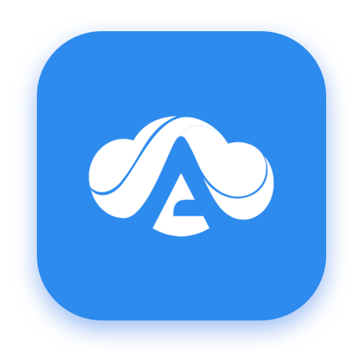

# AntCloud for Windows

**Your AntCloud gaming PC, one click away, with a client that's nicer to use.**<br>
Start the cloud PC, watch it boot, and play. Pairing with Moonlight happens on its own.

<p>
  <a href="https://github.com/Sammy970/AntCloudWin/releases/latest"></a>
  
  
  
  
  
</p>

<p><a href="#download"><b>Download</b></a> &nbsp;·&nbsp; <a href="#the-whole-session-in-one-window">Screenshots</a> &nbsp;·&nbsp; <a href="#an-overlay-while-you-play">Overlay</a> &nbsp;·&nbsp; <a href="#why-another-windows-client">Why</a> &nbsp;·&nbsp; <a href="#how-it-works">How it works</a> &nbsp;·&nbsp; <a href="#project-layout">Project layout</a> &nbsp;·&nbsp; <a href="#made-by">Made by</a></p>

</div>

> [!IMPORTANT]
> **Unofficial project.** This is an independent client built by a user. It is not made, endorsed or supported by AntCloud.
> "AntCloud" and the AntCloud logo belong to their owners. Use it with your own AntCloud account, and follow AntCloud's terms of service.

> [!NOTE]
> **Early preview.** This is a port of [AntCloud for Mac](https://github.com/Sammy970/AntCloudMac), which has been used end to end. The Windows build is developed on a Mac and hasn't had much time on real Windows PCs yet, so if something breaks, please [open an issue](https://github.com/Sammy970/AntCloudWin/issues) with your log from `%APPDATA%\AntCloud\Logs\antcloud.log`.

<br>

<p align="center">
  <picture><source media="(prefers-color-scheme: dark)" srcset=".github/screenshots/dark-login.png">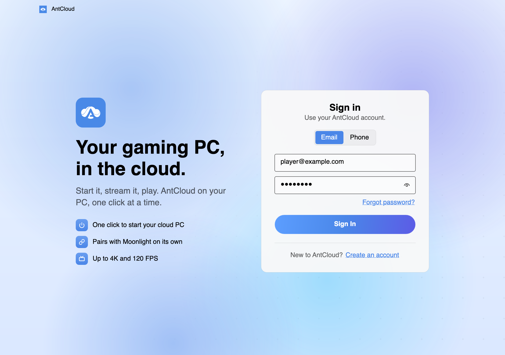</picture>
</p>

<br>

## The whole session in one window

The home screen is built around one question: what is my cloud PC doing right now?
A drawn monitor shows the answer, the track below it shows how far along you are, and there is only ever one main button.

<table>
  <tr>
    <td width="33%" valign="top">
      <picture><source media="(prefers-color-scheme: dark)" srcset=".github/screenshots/dark-step-idle.png">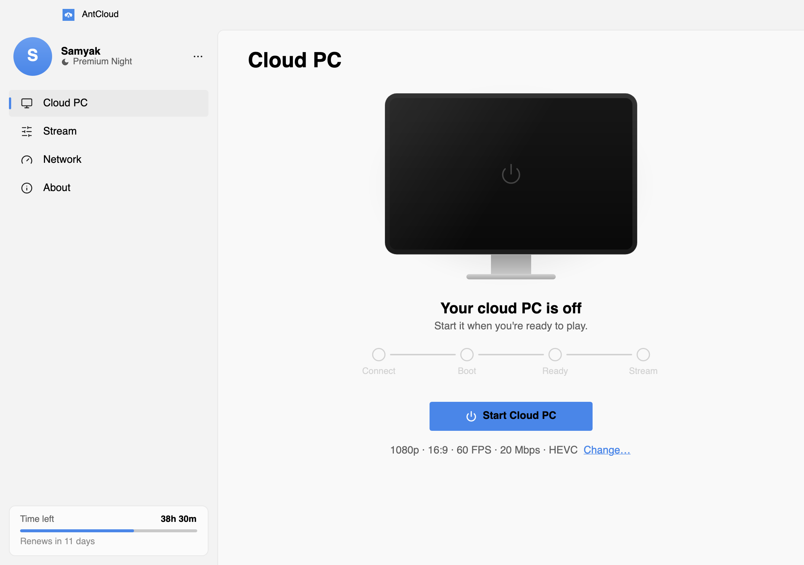</picture>
      <p align="center"><b>Off</b><br><sub>One button to start.</sub></p>
    </td>
    <td width="33%" valign="top">
      <picture><source media="(prefers-color-scheme: dark)" srcset=".github/screenshots/dark-step-queued.png">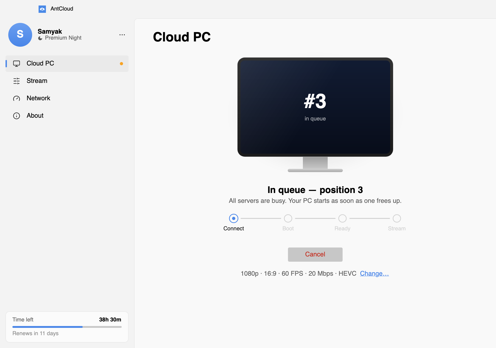</picture>
      <p align="center"><b>In the queue</b><br><sub>Your live position while servers are busy.</sub></p>
    </td>
    <td width="33%" valign="top">
      <picture><source media="(prefers-color-scheme: dark)" srcset=".github/screenshots/dark-step-booting.png">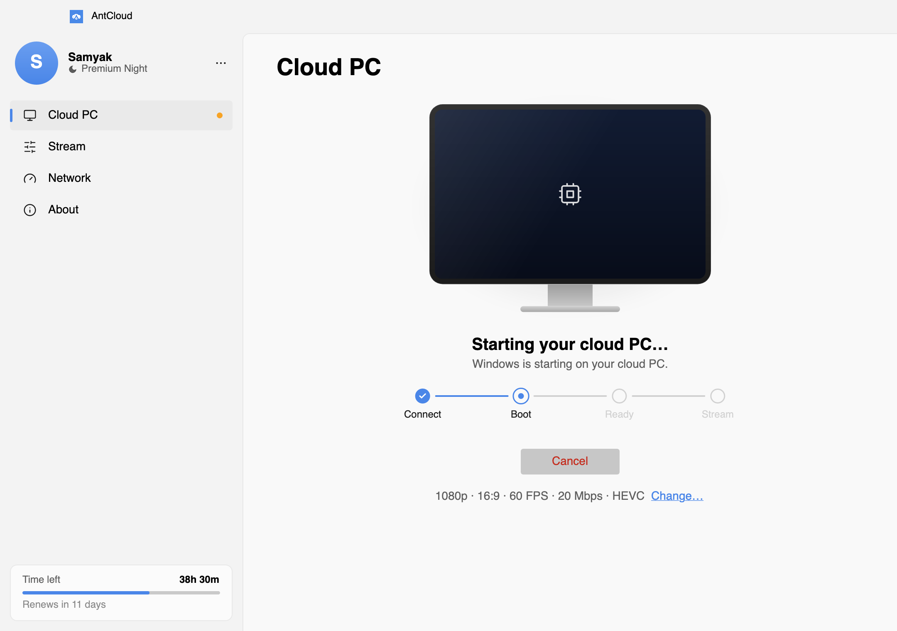</picture>
      <p align="center"><b>Booting</b><br><sub>Windows starts on the cloud PC.</sub></p>
    </td>
  </tr>
  <tr>
    <td width="33%" valign="top">
      <picture><source media="(prefers-color-scheme: dark)" srcset=".github/screenshots/dark-step-ready.png">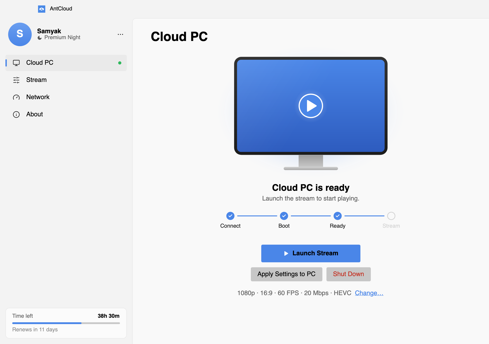</picture>
      <p align="center"><b>Ready</b><br><sub>Launch the stream when you are.</sub></p>
    </td>
    <td width="33%" valign="top">
      <picture><source media="(prefers-color-scheme: dark)" srcset=".github/screenshots/dark-step-pairing.png">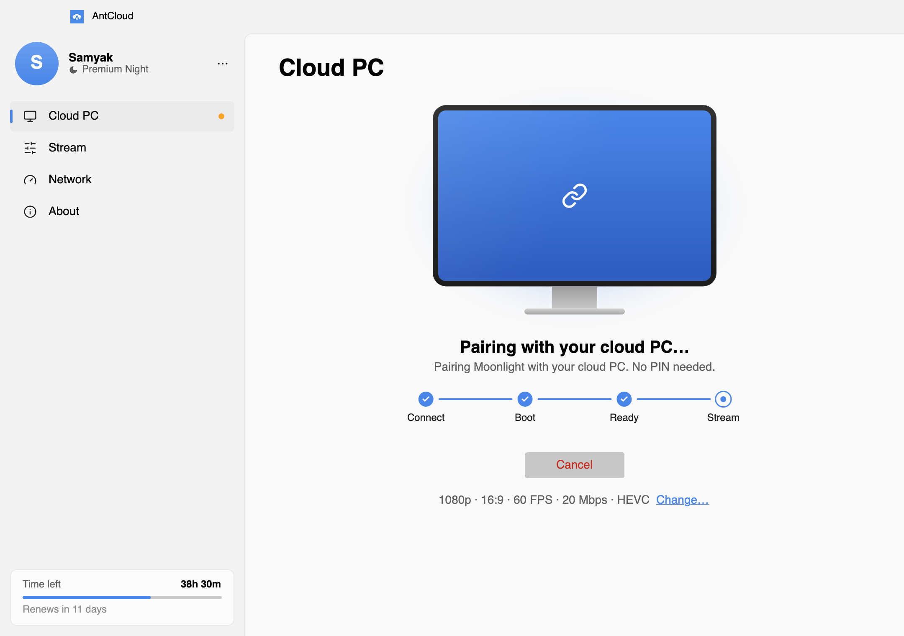</picture>
      <p align="center"><b>Pairing</b><br><sub>Moonlight pairs itself. No PIN to type.</sub></p>
    </td>
    <td width="33%" valign="top">
      <picture><source media="(prefers-color-scheme: dark)" srcset=".github/screenshots/dark-step-streaming.png">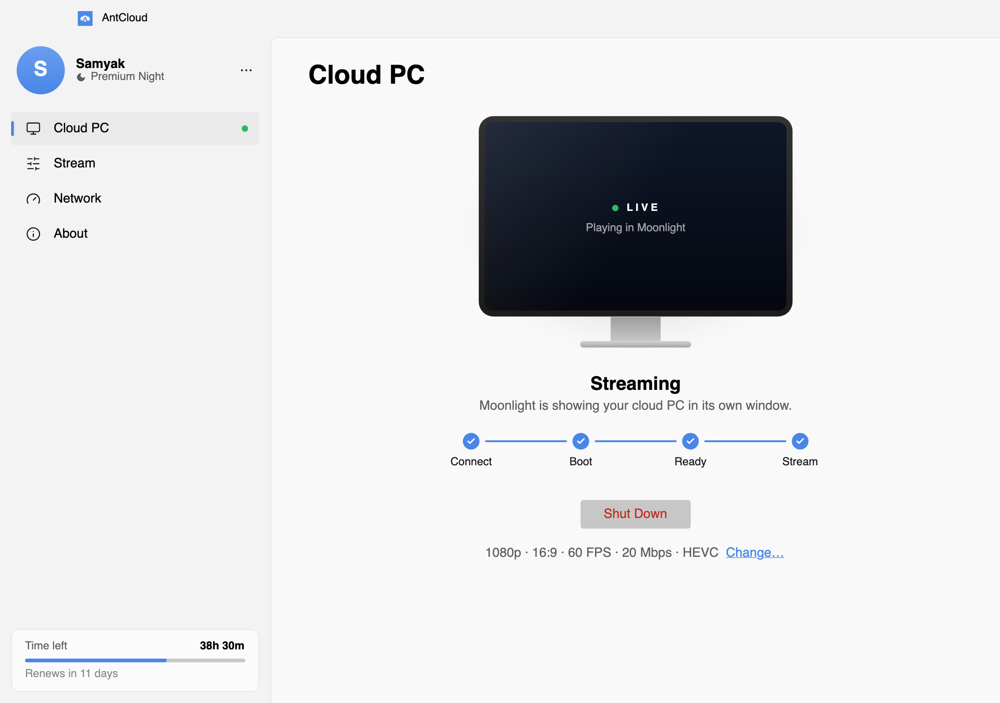</picture>
      <p align="center"><b>Streaming</b><br><sub>You're playing. The app waits in the background.</sub></p>
    </td>
  </tr>
</table>

## Stream settings that explain themselves

<table>
  <tr>
    <td width="42%" valign="top">
      <p>Laid out like Windows Settings, with the numbers that matter right under each choice.</p>
      <ul>
        <li><b>Display:</b> 720p to 4K, 16:9, 16:10 or 21:9, and fullscreen that also sends Alt+Tab and the Windows key to the cloud PC. Shows the exact stream size, e.g. 1920 × 1200.</li>
        <li><b>Performance:</b> 30, 60 or 120 FPS and 5 to 50 Mbps, with the most data you'll use per hour.</li>
        <li><b>Codec &amp; audio:</b> HEVC for a sharper picture at the same bitrate, and microphone forwarding.</li>
      </ul>
      <p>Settings lock while you're streaming, and the home screen always shows a one-line summary such as <code>1080p · 16:9 · 60 FPS · 20 Mbps · HEVC</code>.</p>
    </td>
    <td width="58%" valign="top">
      <picture><source media="(prefers-color-scheme: dark)" srcset=".github/screenshots/dark-settings.png">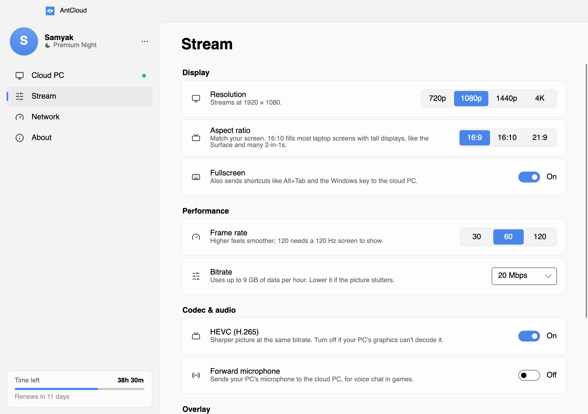</picture>
    </td>
  </tr>
</table>

## Check your connection before you start

<table>
  <tr>
    <td width="58%" valign="top">
      <picture><source media="(prefers-color-scheme: dark)" srcset=".github/screenshots/dark-network.png">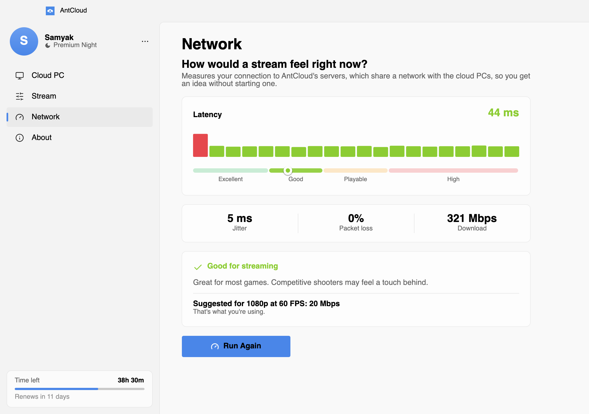</picture>
    </td>
    <td width="42%" valign="top">
      <p>The <b>Network</b> page tells you how a stream would feel without starting the cloud PC.</p>
      <ul>
        <li><b>Latency</b> to AntCloud's servers, which share a network with the cloud PCs, so it's a close stand-in for the real thing. Twenty samples fill in live and a marker settles on Excellent, Good, Playable or High.</li>
        <li><b>Jitter, packet loss and download speed</b>, the last measured through Cloudflare.</li>
        <li><b>A plain verdict</b> and the bitrate your resolution and frame rate actually need, with one click to use it.</li>
      </ul>
    </td>
  </tr>
</table>

## An overlay while you play

<table>
  <tr>
    <td width="40%" valign="top">
      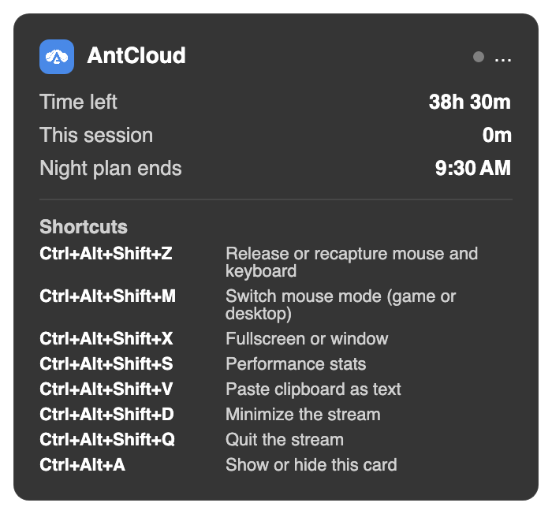
    </td>
    <td width="60%" valign="top">
      <p>Press <kbd>Ctrl</kbd><kbd>Alt</kbd><kbd>A</kbd> during a stream for a small card in the corner, over the game:</p>
      <ul>
        <li><b>Time left</b> on your plan, counting down, and how long this session has run</li>
        <li><b>When a night plan ends</b> and your <b>live latency</b> to the cloud PC</li>
        <li><b>Moonlight's own shortcuts</b>, so you don't have to remember them: release the mouse, switch mouse mode, fullscreen, stats, paste, minimize, quit</li>
      </ul>
      <p>It never takes the keyboard or mouse from the game, and hides when it has nothing to show. It also speaks up on its own when the cloud PC's connection gets busy (a game download on it doubled latency in testing) and when 10 minutes of plan time are left.</p>
      <p><sub>Fullscreen streams run borderless so the overlay can sit on top. You can turn it off under Stream → Overlay.</sub></p>
    </td>
  </tr>
</table>

## Clear messages when something goes wrong

<table>
  <tr>
    <td width="50%"><picture><source media="(prefers-color-scheme: dark)" srcset=".github/screenshots/dark-notice.png">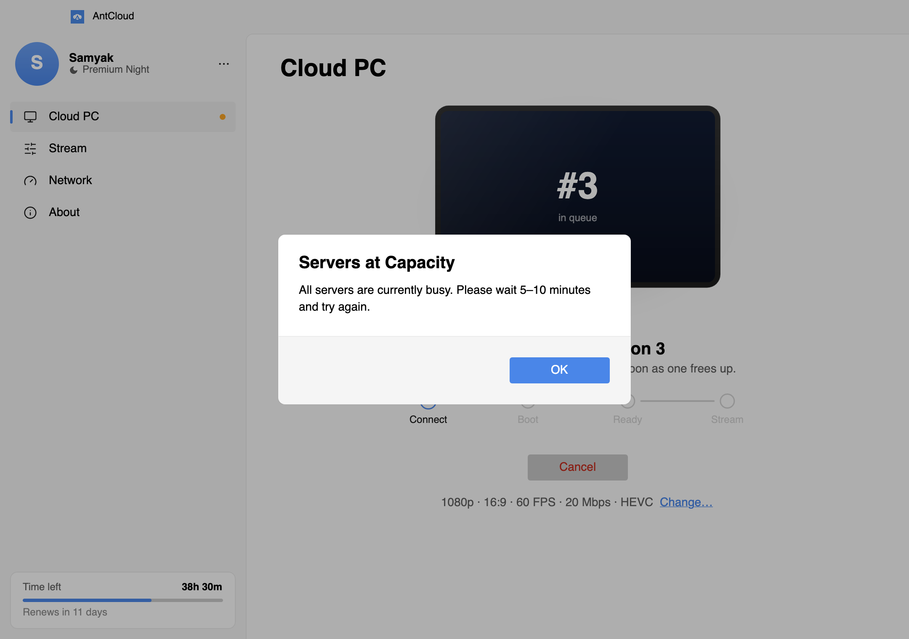</picture></td>
    <td width="50%" valign="top">
      <p>Every reason AntCloud's server gives for stopping a session (servers full, plan over, email not verified, another stream running, outside night-plan hours, the VM failing to start) gets a plain sentence saying what happened and what to do, not a code.</p>
      <p>Close the window while your cloud PC is running and it asks first, then shuts the PC down, so you aren't billed for a PC you forgot about.</p>
    </td>
  </tr>
</table>

## Light and dark

The app follows Windows' light or dark mode, with Mica on Windows 11. AntCloud blue is the only accent colour.

<table>
  <tr>
    <td width="50%"></td>
    <td width="50%">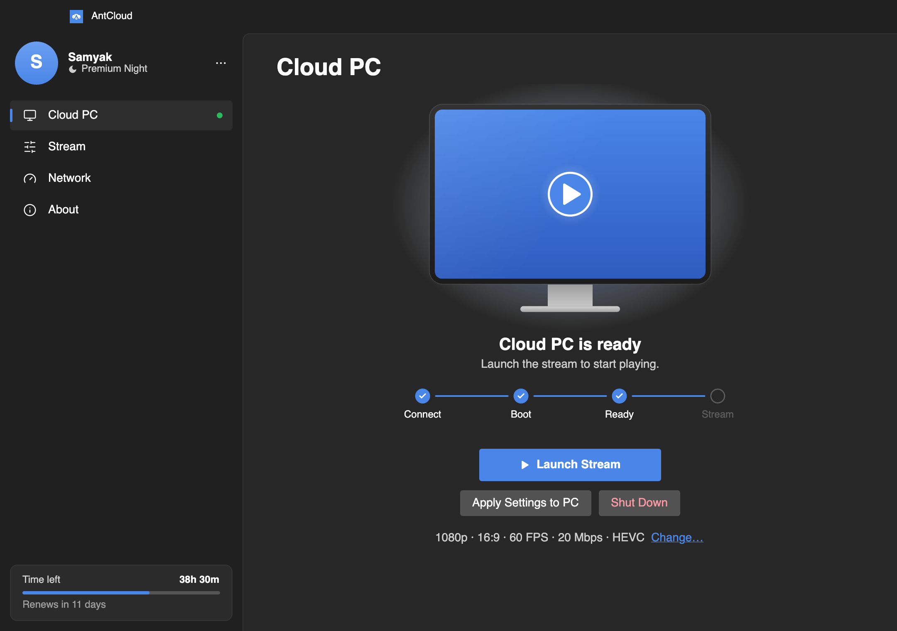</td>
  </tr>
  <tr>
    <td width="50%"></td>
    <td width="50%">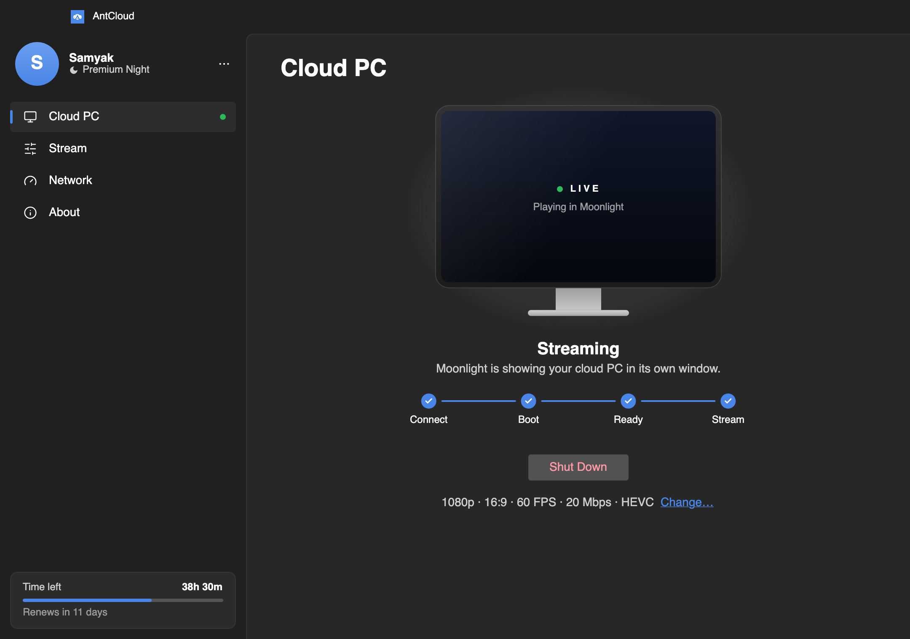</td>
  </tr>
</table>

## Why another Windows client

AntCloud ships its own Windows app. This one is an alternative to it:

- **Nothing extra to install.** One folder: `AntCloud.exe` plus Moonlight's portable build next to it. No .NET runtime or WebView2 needed.
- **Your sign-in stays private.** The refresh token is encrypted for your Windows account with DPAPI, so another user on the PC, or a copied file, can't read it.
- **Its own Moonlight.** The bundled Moonlight is the unmodified upstream release, and it keeps its pairings in its own folder, so it never touches a Moonlight you installed yourself.
- **Smaller:** an 81 MB zip, against 112 MB for AntCloud's installer.
- **The extras from the Mac app:** the network check, the in-stream overlay, health warnings and night-plan awareness.

## Features

- **Sign in** with email and password or a phone code.
- **One-click cloud PC.** Handles the queue, the boot and the readiness checks.
- **Automatic pairing.** The app generates the PIN and sends it to AntCloud, so Moonlight pairs without any typing.
- **Your plan in the sidebar.** Time left this month, the renewal date and a readable plan name, like "Premium Night".
- **Microphone forwarding** to the cloud PC.
- **Night-plan aware.** Checks the server clock before starting, so outside 12:30–9:30 AM IST it tells you
  instead of booting the PC, and ends the session at the plan's cutoff like the official client.
- **Network check** without starting the cloud PC, with a verdict and a bitrate suggestion for your settings.
- **In-stream overlay** on <kbd>Ctrl</kbd><kbd>Alt</kbd><kbd>A</kbd> with time left, live latency and Moonlight's shortcuts.
- **Motion with a purpose:** the monitor powers on, the track fills step by step, and a failed sign-in shakes.
  Turning off animation effects in Windows turns it all off.

## Download

**[Download AntCloud for Windows](https://github.com/Sammy970/AntCloudWin/releases/latest)**: no building needed.

1. Download `AntCloud-<version>-win-x64.zip` and unzip it anywhere, for example to your Documents folder.
2. Open the folder and run **AntCloud.exe**. Keep the `Moonlight` folder next to it.
3. The app isn't code-signed, so the first time Windows SmartScreen may say it "protected your PC". Click **More info → Run anyway**. You only have to do this once.

Needs Windows 10 or 11, 64-bit.

## Building it yourself

You need the [.NET 10 SDK](https://dotnet.microsoft.com/download). It builds on Windows, macOS or Linux.

```sh
dotnet run                          # run in development
scripts/package-windows.sh          # → dist/AntCloud-<version>-win-x64.zip, with portable Moonlight
```

`dotnet run` also works on a Mac, where it streams through `/Applications/Moonlight.app`. That's how this app is developed.

<details>
<summary><b>Preview mode</b>, for working on the UI</summary>
<br>

Any screen can be opened with a sample account, without touching your stored sign-in or the API.
This is how the screenshots above were made.

```sh
ANTCLOUD_PREVIEW=home:ready dotnet run
ANTCLOUD_PREVIEW=login ANTCLOUD_THEME=light ANTCLOUD_SNAPSHOT=login.png dotnet run
```

| Variable | Values |
|---|---|
| `ANTCLOUD_PREVIEW` | `login`, `home:idle`, `home:queued`, `home:booting`, `home:ready`, `home:pairing`, `home:streaming`. Add `:stream`, `:network`, `:about`, `:overlay` or `:notice`. |
| `ANTCLOUD_THEME` | `light` or `dark` |
| `ANTCLOUD_SNAPSHOT` | Saves the window as a PNG after it settles, then quits (`ANTCLOUD_SNAPSHOT_DELAY` sets the wait in seconds) |

</details>

## When AntCloud changes things

AntCloud has no public API; this app uses the one its own Windows app uses, and that can change without notice.
On 30 Oct 2026 their Windows app 0.016 renamed every route, and sign-in stopped working. So:

- **At launch**, a banner appears when AntCloud ships a newer Windows app than the one this code matches.
- **When a route disappears**, the app says AntCloud changed their service instead of showing a bare error.

## How it works

```
Sign in ──▶ Start Cloud PC ──▶ queue ──▶ boot ──▶ ready
                                                    │
                                              Launch Stream
                                                    │
                     get VM address ──▶ pair (auto PIN) ──▶ Moonlight stream
```

1. A Socket.IO session queues and boots your cloud PC, and reports each step.
2. The app polls until the PC is reachable, then tells the server to start video.
3. **Launch Stream** fetches the PC's address, applies your display settings, pairs if needed and starts Moonlight.

## Project layout

| Path | What's there |
|---|---|
| `Core/Api/` | API client, profile, the "AntCloud changed something" check |
| `Core/Auth/` | Sign-in and the DPAPI-encrypted refresh token |
| `Core/Session/` | Socket.IO session, stream settings, network check, stream health |
| `Core/Stream/` | Moonlight runner and driver, microphone forwarding |
| `Views/` | Sign-in, sidebar, Cloud PC, Stream, Network and About pages, the overlay window |
| `Controls/` | The drawn monitor, connection track, aurora, latency charts and icons |
| `scripts/package-windows.sh` | Builds the self-contained zip with portable Moonlight |

Settings, the token and logs live in `%APPDATA%\AntCloud\`.

## Made by

<table>
  <tr>
    <td width="96" valign="middle"><a href="https://github.com/Sammy970"></a></td>
    <td valign="middle">
      <b>Samyak Jain</b><br>
      <sub>Designed and built AntCloud for Windows, Mac and iPhone, from reverse-engineering AntCloud's Windows app to the last animation.</sub><br><br>
      <a href="https://github.com/Sammy970"></a>
      <a href="https://x.com/Sammy_970"></a>
    </td>
  </tr>
</table>

Also available: [AntCloud for Mac](https://github.com/Sammy970/AntCloudMac) and [for iPhone](https://github.com/Sammy970/AntCloudMoonlight). If this helped you play, a ⭐ on the repo or a hello on X is always welcome.

<p align="center">
  <picture><source media="(prefers-color-scheme: dark)" srcset=".github/screenshots/dark-about.png">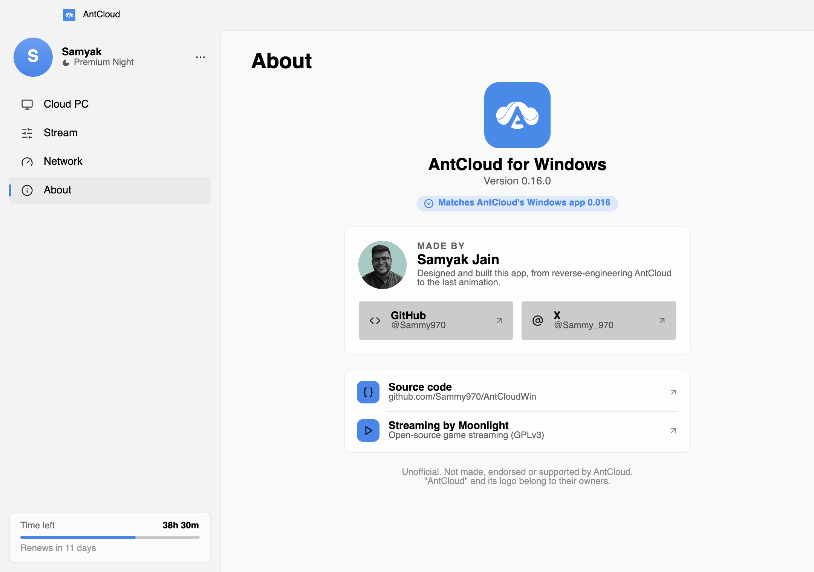</picture>
  <br><sub>The same credits live in the app, under <b>About</b>.</sub>
</p>

## Versioning

`0.<AntCloud release>.<ours>`: **0.16.x** works with AntCloud's Windows app **0.016**. The middle number moves when
AntCloud changes its API and this app catches up (0.17.0 for their 0.017); the last one counts our own releases.
It's set in `Core/Config.cs` (`AppVersion`) and the `<Version>` in `AntCloudWin.csproj`.

## Notes

Unofficial client, not affiliated with AntCloud. Streaming uses the official
[Moonlight](https://github.com/moonlight-stream/moonlight-qt) app (GPLv3), bundled unmodified.
